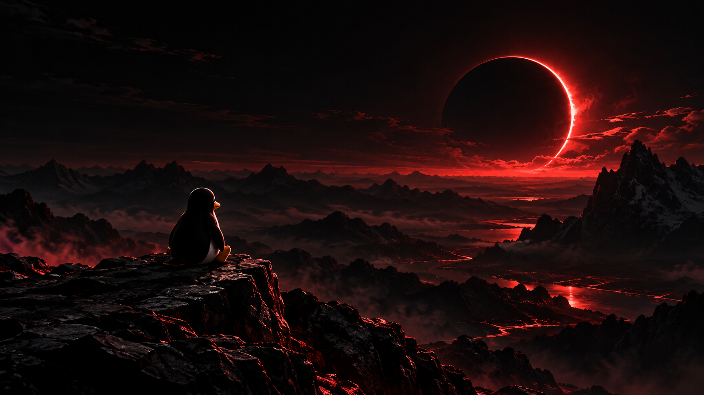

# Redline Rice

Steven’s Omarchy ricing bundle: **taskbar, nine shell plugins, six matching theme colors, Tux wallpapers, Fastfetch, and terminal settings**. This is a separate distribution of [Redline Desktop](https://github.com/stspivey76-byte/omarchy-redline-desktop), with terminal configuration added.

## Terminal setup

After installing the theme below, clone this repository and install the terminal settings:

```bash
git clone https://github.com/stspivey76-byte/omarchy-redline-rice.git
cd omarchy-redline-rice
python3 scripts/install-terminal.py
```

Includes Alacritty, Foot, Ghostty, and Kitty configs. Alacritty, Foot, and Ghostty use JetBrainsMono Nerd Font at size 9 with 14-pixel padding; Kitty follows Omarchy defaults. Theme colors follow the active Omarchy theme. The fixed red Foot override from the original desktop was removed so all six colors can work. Install your preferred terminal and font separately. These configs require Omarchy; the shared theme supports the other desktop profiles listed below.

The terminal installer backs up existing files and prints an exact restore command. Open a new terminal window afterward. Fastfetch configuration is installed with the theme; run `fastfetch` to display it. No shell startup files or command history are exported.

**Existing Redline users:** this bundle manages the same Redline theme/plugin files and updater as Redline Desktop. Install one distribution at a time. Installing this version switches future Redline release checks to this repository. Terminal settings are installed separately and are not managed by automatic repair or the theme uninstaller; use the printed terminal restore command to undo them.


Steven’s red and black desktop theme, crimson Tux wallpapers, custom Fastfetch logo, and Omarchy shell plugins. The installer opens a terminal color picker, detects your active desktop, and applies the supported settings for that desktop.



## Install or update

Run this from a terminal in your normal desktop session, without `sudo`:

```bash
curl -fsSL https://raw.githubusercontent.com/stspivey76-byte/omarchy-redline-rice/main/download.sh | bash
```

Requires Linux, Bash, Python 3, `curl`, and `sha256sum`. It downloads the latest release ZIP, checks its SHA-256 checksum, backs up affected files/settings, and installs the matching profile. It does not install desktop environments or packages. Fastfetch must already be installed to display the bundled logo and layout.

For a manual install, download [redline-desktop.zip from the latest release](https://github.com/stspivey76-byte/omarchy-redline-rice/releases/latest), extract it, and run `bash install.sh` inside the extracted `redline-desktop` directory. No Git checkout is needed.

Run the same command again to update. Updates replace the bundled theme, Fastfetch layout, and (on Omarchy) plugins/shell layout. Save custom changes first. Existing GTK CSS rules are preserved after the managed Redline import and can override its colors.

## Choose your color

The normal copy-and-paste command opens a menu **inside your terminal**, with a Tux-and-eclipse ASCII banner, colored swatches, and a highlighted current selection, including when run through `curl | bash`. Pick a number or type a color name:

```text
REDLINE DESKTOP — Same desktop. Choose your color.

1  Red       2  Blue       3  Green
4  Yellow    5  Pink       6  Purple
```

Enter keeps your saved choice (red for a first install); `q` cancels before installation. All six options keep the same nine plugins, layout, and Tux/eclipse wallpaper design. The chosen color applies to the taskbar text, workspace pills, spectrum, resource meters, volume accents, media clone, popups, GTK styling, KDE scheme, and Fastfetch logo/layout. The matching wallpaper is selected automatically on desktops with wallpaper adapters. Other sessions receive the selected wallpaper file for manual application. Native third-party tray icons can retain their application's own artwork.


The original crimson wallpaper and five matching variants are bundled. See the [wallpaper files and generation notes](docs/wallpaper-color-prompts.md). No image-generation tools or extra packages are needed to install them.

Run the same install command again to change colors through the menu. Manual installs require a terminal and always use the menu; there is no direct color-selection flag. The desktop/profile options still work with the menu.

Automatic updates and repairs **keep your saved color and never open the menu**. Omarchy briefly restarts its shell after installation to clear compiled widget caches, so the whole taskbar uses the chosen color. GTK apps may need reopening after a color change. The original `tux-crimson-eclipse.png` installed filename is retained for compatibility, and its contents match the selected color.

## Automatic updates and repairs

Automatic updates are enabled by default when installing this release. Existing users need to run the install command once to add the updater. It runs as your normal user, starts at login through XDG autostart (plus an Omarchy post-boot hook), and starts immediately after installation. No root access, package installation, or Git checkout is required.

- Checks GitHub’s latest stable release hourly while logged in. Newer numeric `vMAJOR.MINOR.PATCH` releases are downloaded, checksum-verified, validated, installed for the detected desktop, and checked for the expected managed files. Older versions and prereleases are not automatically installed.
- Checks bundled theme/plugin files and required configuration files every five minutes, after an initial one-minute delay. Missing/changed bundled theme/plugin files and logos are reinstalled from the cached release, including while offline. Missing shell/Fastfetch/GTK files are restored. Existing shell layouts and Fastfetch configurations are not continually compared byte for byte.
- Takes a managed-file snapshot before each automatic install/repair. If the installer fails or managed files fail verification, the updater restores those files, logs the error, and retries with a delay. Omarchy’s previous theme/background are reapplied when possible. Native desktop settings may need the installer’s saved restore command and a session restart after a failed desktop migration.
- Pauses scheduled changes while another Omarchy theme is selected or Redline’s GTK imports are deliberately disabled. It checks the active desktop at each run; only the active login session runs checks when `loginctl` is available. One install/update runs at a time.

**Repairs replace edits to bundled theme/plugin files.** To keep custom edits, turn off managed-file repair or disable automatic updates. Every update or repair reruns the bundled installer and can replace shell/Fastfetch layouts and Omarchy idle settings, even when the original trigger was one damaged plugin. Save custom layouts or disable automatic installation if you want to maintain those yourself. This is file repair and release delivery, not a guarantee of fixing unknown bugs or future Omarchy/desktop API changes. Compatibility fixes still need to be included in a published release. GTK apps may need to be reopened to show new colors; Omarchy user plugins normally reload on save.

The helper is installed at `~/.local/bin/redline-update`:

```bash
~/.local/bin/redline-update --status        # Installed version, profile, last result, log path
~/.local/bin/redline-update --check         # Check/install the latest release now
~/.local/bin/redline-update --repair        # Reinstall/repair now, even without a newer release
~/.local/bin/redline-update --updates-only  # Keep release updates; stop checking for file changes
~/.local/bin/redline-update --enable-repair # Enable managed-file repair again
~/.local/bin/redline-update --disable       # Stop automatic updates/repairs
~/.local/bin/redline-update --enable        # Enable and start background checks again
```

Manual `--check` and `--repair` can reapply Redline even if another theme is selected. Disabled background checks stop at their next polling interval; an install already in progress finishes. Desktops/window managers without XDG autostart support can launch `~/.local/bin/redline-update --watch` at login. Omarchy uses its post-boot hook as well. An Omarchy `post-update` hook also checks for a newer Redline release and reapplies the cached bundle after a system update when repair is enabled. Disabled updates, inactive Redline themes, and the updates-only preference are respected.

To install without enabling background updates:

```bash
curl -fsSL https://raw.githubusercontent.com/stspivey76-byte/omarchy-redline-rice/main/download.sh | bash -s -- --no-auto-update
```

Reinstalling preserves an existing disabled/updates-only preference. Use the helper’s `--enable` / `--enable-repair` controls to change it.

Updater code and cached releases live under `${XDG_DATA_HOME:-~/.local/share}/redline-updater/`. Status, logs, and managed-file snapshots live under `${XDG_STATE_HOME:-~/.local/state}/redline-updater/`. Installer backups are kept separately as described below; no backups are automatically deleted. Logs rotate at about 1 MiB. Background checks require an active login session, and release downloads require internet access. An offline release check keeps the current version and cached repair remains available.

## Desktop detection and support

Detection uses `XDG_CURRENT_DESKTOP`, `XDG_SESSION_DESKTOP`, and `DESKTOP_SESSION`. Omarchy is selected for an active Hyprland session with Omarchy installed. Having Omarchy installed while logged into another desktop does not select its profile.

| Active desktop/profile | Applied automatically |
| --- | --- |
| Omarchy on Hyprland | Full original theme, wallpaper, nine shell plugins, bar layout, idle settings, GTK colors, Fastfetch |
| GNOME / Budgie | GTK colors, dark preference, wallpaper (including GNOME dark variant), Fastfetch |
| KDE Plasma | Native Redline color scheme for Plasma/Qt apps such as Dolphin, wallpaper, GTK colors, Fastfetch |
| Xfce | GTK colors, dark GTK theme, wallpaper for existing monitor/workspace properties, Fastfetch |
| Cinnamon | GTK colors, dark GTK theme, wallpaper, Fastfetch |
| MATE | GTK colors, dark GTK theme, wallpaper, Fastfetch |
| LXQt / LXDE | GTK colors, wallpaper through PCManFM-Qt/PCManFM, Fastfetch |
| Other desktops/window managers | GTK colors, Fastfetch, and persistent wallpaper files; select the wallpaper manually |

This makes the shared assets usable outside Hyprland; it does **not** translate Omarchy plugins into GNOME extensions, Plasma widgets, or other desktop panels. Omarchy’s bar, plugins, lock/idle settings, and shell styling remain specific to Omarchy’s Quickshell shell. Other desktop panels, window decorations, login screens, and icon themes retain their own configuration. LXQt’s Qt widget colors need separate configuration in Appearance settings; its GTK apps receive Redline colors. Unknown desktops receive the shared assets and an explicit notice about manual wallpaper selection.

Native adapters require their desktop’s normal settings tools (`gsettings`, Plasma apply utilities, `xfconf-query`, or the running PCManFM desktop manager). Missing tools, settings, or session services are reported as skipped, rather than silently claiming full application. A profile with notices may need manual steps. Flatpak sandbox permissions are not changed.

To preview detection without changing anything:

```bash
bash install.sh --detect
```

To override detection, for example on KDE:

```bash
bash install.sh --desktop kde
```

Or pass the profile directly to the download command:

```bash
curl -fsSL https://raw.githubusercontent.com/stspivey76-byte/omarchy-redline-rice/main/download.sh | bash -s -- --desktop kde
```

Profiles: `auto`, `omarchy`, `gnome`, `kde`, `xfce`, `cinnamon`, `mate`, `budgie`, `lxqt`, `lxde`, `generic`. Select the profile for your current session. Generic mode applies only the shared assets and is useful when no native adapter matches your desktop.

## Included

- Redline GTK 3 and GTK 4/libadwaita styling: near-black file views, crimson headers/sidebar, red selections, light text.
- Native `Redline.colors` scheme for KDE Plasma/Qt apps.
- Original crimson Tux wallpaper, matching blue/green/yellow/pink/purple variants, and the black background.
- Custom Omarchy Eclipse Fastfetch logo and red/orange information layout. Outside Omarchy, its Omarchy-specific probes are replaced with portable Fastfetch modules.
- Omarchy color palette, shell styling, top bar, and idle settings (screensaver at 150 seconds, lock at 300).
- Nine Omarchy plugins: bar, workspaces, active window, clock/calendar, weather, resources, spectrum, updates, and media. The saved Omarchy layout uses the built-in media widget.

For the full Omarchy profile, use a compatible Quickshell-based Omarchy shell/plugin API. Python 3 powers resource meters and update checks. Spectrum needs `pactl` and `parec` (Arch package `libpulse`). Weather uses `curl`, Open-Meteo, and wttr.in. Update checks use installed tools such as `checkupdates`, `yay`, `mise`, `flatpak`, and `fwupdmgr`.

## Uninstall and restore previous settings

For installations made with this version, run in a terminal:

```bash
redline-uninstall
```

Or run `bash uninstall.sh` from an extracted download. Review the confirmation before proceeding; `--yes` skips it. The uninstaller stops the background updater and replays all installation backups, newest first, restoring the files, wallpaper, theme, plugins and native desktop settings saved before installation. Files created by Redline are removed; files and symlinks that existed beforehand are restored. Repeated installs and color changes retain the original baseline. Keep the backup directories: without them, exact restoration is impossible. This restores installer-managed files and recorded desktop settings; third-party Omarchy theme hooks, browser policies, editor integrations, installed packages, and hardware lighting can have additional effects that are not captured by these backups.

Newer edits to affected files are replaced. Before restoring, the uninstaller saves current affected files in an `uninstall-*` directory under the installer backup directory, with a `files.json` mapping. Existing installation backups remain available. Log out and back in afterward so applications reload their restored settings. For Plasma, LXQt and LXDE, log out first and run from a text console; the uninstaller refuses to run in a graphical session on these profiles.

**Older installations:** earlier Omarchy releases did not capture a complete restore manifest. Installing this version over an old installation cannot reconstruct settings that were never saved. Use the older backups described below to recover what is available; full automatic restoration is supported starting with a fresh installation of this version. Older portable installations with complete manifests can use `bash uninstall.sh` from this version.

## Backups and restore

On non-Omarchy desktops, the installer respects `XDG_CONFIG_HOME`, `XDG_DATA_HOME`, and `XDG_STATE_HOME`. Shared theme/wallpaper files live under `${XDG_DATA_HOME:-~/.local/share}/redline-desktop/`. The printed backup directory lives under `${XDG_STATE_HOME:-~/.local/state}/redline-desktop/backups/` and contains a restore script plus saved files and native settings. To undo an installation, run the exact command printed by that installation:

```bash
python3 /path/to/printed/backup/restore.py
```

Restore updates in reverse order. For GNOME, Budgie, Cinnamon, MATE, and Xfce, restore in the original desktop session, then log out and back in so cached settings reload. For Plasma, LXQt, and LXDE, log out first and run the restore command from a text console so the desktop cannot overwrite restored configuration; then log back in. Restore replaces affected files with their saved versions, so save any newer edits first.

The Omarchy profile keeps its original backup layout at `~/.local/state/omarchy/backups/redline-desktop-*` (or under `XDG_STATE_HOME`). Restore `shell.json`, `shell.toml`, `themes/redline`, and plugins to `~/.config/omarchy/`; restore `fastfetch/`, `gtk-3.0/`, and `gtk-4.0/` to their respective directories under `~/.config/`. The saved Redline hook, if present, belongs at `~/.config/omarchy/hooks/theme-set.d/redline-gtk`. If a replaced file had no previous version, remove the installed file to undo it. Reapply your previous Omarchy theme. Omarchy itself expects the standard `~/.config` directory.

## Window appearance

On Omarchy, Redline includes 18-pixel window corners, soft shadows, slim borders,
and balanced window spacing. Personal Hyprland settings loaded after the theme
can override these defaults. GTK 3/4 controls and popovers use matching rounded
corners across the six palettes. Other desktops retain control of outer window
corners and shadows. These visual settings do not modify plugins or shell layout.

## GTK styling

Close and reopen GTK apps after installing or changing styling. The imports in `gtk-3.0/gtk.css` and `gtk-4.0/gtk.css` layer Redline colors over the apps’ base styles; existing custom CSS can take precedence. Icons are unchanged.

On Omarchy, a `theme-set` hook enables the imports for Redline and removes them when switching themes. Disable them manually with:

```bash
bash ~/.config/omarchy/hooks/theme-set.d/redline-gtk disabled
```

On other desktops, disable them with:

```bash
bash "${XDG_DATA_HOME:-$HOME/.local/share}/redline-desktop/gtk-style.sh" disabled
```

Reinstall to re-enable, or on a non-Omarchy desktop run:

```bash
bash "${XDG_DATA_HOME:-$HOME/.local/share}/redline-desktop/gtk-style.sh" redline "${XDG_DATA_HOME:-$HOME/.local/share}/redline-desktop/theme"
```

## Validation

Blue wallpaper and the complete Omarchy taskbar were visually verified together after clearing the shell’s compiled QML cache.

GNOME Files 50.3.1 styling was visually verified on Omarchy/Hyprland, including dark views, crimson headers/sidebar, and red selected files. The temporary Files installation and its dependencies were removed afterward.

Desktop detection, native command routing, custom XDG paths, symlink/CSS preservation, repeat installs, and portable restore are tested with isolated homes and mocked desktop tools. Updater tests cover newer-release installation, checksum rejection, downgrade prevention, offline repair, disabled/inactive themes, update locks, CLI controls, and file rollback after a simulated partial failure.

Other desktop sessions have **not** been visually tested; automated adapter coverage does not establish identical rendering on every desktop/version.

Color-picker tests cover all six palettes, plugin/layout preservation, selected wallpapers, readable selection text, number/name/default/cancel input, and a piped installation reading from a real controlling terminal. Update tests retain a purple choice across upgrades and repairs.

Run the checks with `python3 -m unittest discover -s tests -v`.

Native settings references: [GNOME background settings](https://help.gnome.org/system-admin-guide/desktop-background.html), [Xfconf CLI](https://docs.xfce.org/xfce/xfconf/xfconf-query), [Plasma color utility](https://github.com/KDE/plasma-workspace/blob/master/kcms/colors/plasma-apply-colorscheme.cpp), [Plasma wallpaper utility](https://github.com/KDE/plasma-workspace/blob/master/wallpapers/image/plasma-apply-wallpaperimage.cpp), and [PCManFM-Qt options](https://github.com/lxqt/pcmanfm-qt/blob/master/pcmanfm/application.cpp).

## Attribution

Several plugins were cloned from Omarchy and retain their original author metadata. Their upstream source is https://github.com/basecamp/omarchy. Existing upstream license terms apply to that code. Wallpaper authorship and redistribution terms have not been established by this export; no new license is asserted for the wallpaper or other included assets. No weather location, credentials, clipboard history, notifications, caches, or old desktop configuration backups are included.
